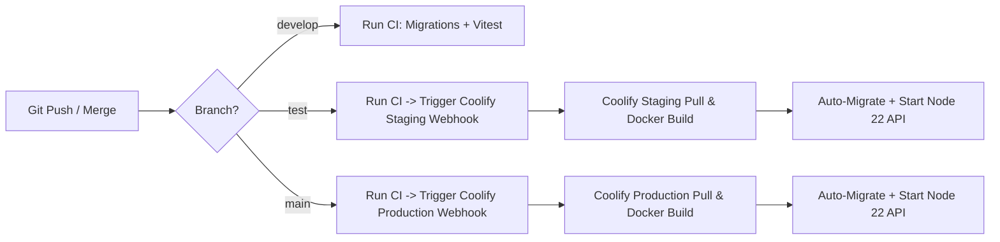

# ISP Customer Service API — Backend Platform

Backend platform for automated omnichannel customer service for an Internet Service Provider (ISP), integrating **WhatsApp Business Cloud API**, **n8n workflow automation**, **PostgreSQL (pgvector)**, **Redis**, and AI reasoning engines (**Google Gemini** & **Ollama/Qwen**).

---

## 1. Architectural Architecture & Principles

This system follows **Hexagonal (Ports and Adapters) Clean Architecture**:

- `src/domain/`: Core business entities, value objects, domain events, and state machine definitions. Completely free of external framework dependencies.
- `src/application/`: Application use cases, command/query handlers, and port interfaces.
- `src/infrastructure/`: Concrete adapters for PostgreSQL, Redis, n8n, WhatsApp Cloud API, AI vision/NLU engines, and external MikroTik/OLT APIs.
- `src/presentation/`: Express routers, REST controllers, middlewares, and WebSocket gateways.
- `src/core/composition/container.ts`: Single composition root / dependency injection container.

### Core Business Rules
- **API as Source of Truth**: The API owns business state. Neither n8n nor AI decides business transitions or financial penalties.
- **Strict Idempotency**: Message intake enforces idempotency via `UNIQUE(conversation_id, external_id)` and inter-service tokens (`idempotencyKey` / `executionId`).
- **Single Active Automated Case**: Only one automated case is active per conversation (`conversation.active_case_id`).
- **Resilient Workflows**: Pausing or resuming a case never restarts workflow progress from step 0.

---

## 2. CI/CD & Deployment Guide (Test & Production)

All deployments to Staging (**Test**) and Production (**Main**) are fully automated through **GitHub Actions** and **Coolify**.

### Pipeline Architecture (`.github/workflows/deploy.yml`)



### Steps to Deploy

#### Deploying to Test (Staging)
1. Merge your approved feature branch into `develop` or directly create a pull request into `test`.
2. Push or merge into the `test` branch:
   ```bash
   git checkout test
   git pull origin test
   git merge feature/your-feature-branch
   git push origin test
   ```
3. GitHub Actions executes:
   - Spins up PostgreSQL (`pgvector/pgvector:pg16`) and Redis (`redis:7`) service containers.
   - Executes `pnpm install --frozen-lockfile`.
   - Runs `pnpm run migrate` to validate migrations against real Postgres.
   - Executes the full Vitest suite (`pnpm run test`).
   - Calls the Coolify Staging Webhook (`COOLIFY_WEBHOOK_TEST`) with `Authorization: Bearer $COOLIFY_API_TOKEN`.
4. Coolify pulls the latest commit, builds the production container, runs pending database migrations, and performs zero-downtime container replacement.

#### Deploying to Production (Prod)
1. Ensure the `test` environment has undergone thorough end-to-end verification.
2. Create a pull request or merge `test` into `main`:
   ```bash
   git checkout main
   git pull origin main
   git merge test
   git push origin main
   ```
3. GitHub Actions validates migrations and tests, then dispatches the `COOLIFY_WEBHOOK_MAIN`.
4. Coolify initiates the production release.

---

## 3. Database Migrations Guide

The backend uses a deterministic, sequential SQL migration runner (`scripts/migrate.ts`).

### Migration Execution
- **In Development**:
  ```bash
  pnpm run migrate
  ```
- **In Production / Coolify**:
  Automated directly via the container entrypoint in `Dockerfile`:
  ```dockerfile
  CMD ["sh", "-c", "node dist/scripts/migrate.js && node dist/src/index.js"]
  ```
  Every time a new container starts, `migrate.js` executes and ensures that any unapplied migration in `migrations/*.sql` is executed inside an atomic transaction before the HTTP server starts accepting traffic.

### Migration Safety Rules
1. **Alphabetical & Sequential Ordering**: Migrations follow `0001_initial.sql`, `0002_...sql`, up to `0042_agent_active_department_ids.sql`.
2. **Atomic Execution**: Every `.sql` file is executed within its own `BEGIN` / `COMMIT` transaction. If an error occurs, it rolls back immediately and aborts container launch.
3. **Tracking**: Executed migrations are recorded in the `schema_migrations` table (`id`, `applied_at`).
4. **Prohibition of Auto-Sync**: Never use ORM `synchronize: true` or auto-schema tools.

---

## 4. n8n Workflows Deployment Guide

Workflow definitions are stored as version-controlled JSON files in `n8n/`:

- `n8n/find-cliend-contract.json`: Queries customer contract details, financial status, and sector/neighborhood names from ERP/Excel feeds.
- `n8n/check-balance.json`: Real-time on-demand balance verification.
- `n8n/record-payment.json`: Payment registry and accounting integration.
- `n8n/apply-bank-account.json`: Bank transfer information delivery.

### How to Update n8n Workflows
1. Log into your n8n web instance (e.g. `http://localhost:5678` or production instance).
2. Open the desired workflow and select **Import from File...** to import the updated JSON.
3. Validate node credentials:
   - **Internal API Key**: Set to the value of `API_INTERNAL_KEY` from the backend `.env`.
   - **MikroTik API URL**: Ensure HTTP Request nodes point to `http://internal_sys_api_mikrotik:3001` (Docker network) or the public URL.
4. Set the workflow toggle to **Active**.

---

## 5. Operations & Bug Fixes Log (2026-10-28)

The following critical issues and production enhancements were identified, diagnosed, and resolved:

### 1. False Positive Payment Receipts (`BILLING_BALANCE` Trap)
- **El Daño (Damage)**: Customers sending photos of technical equipment (e.g., optical routers with red LOS lights, disconnected cables, black TV screens) were erroneously classified by the intake system as payment receipts. The bot sent an automated response *"Estamos verificando tu comprobante de pago... por favor espera un momento"*, permanently paused the bot, and blocked customers from receiving technical support.
- **El Porqué (Root Cause)**: `GeminiVisionAdapter` returned an empty receipt entity object (`{}`) when an image lacked bank voucher details. In `process-buffered-messages.use-case.ts`, `Object.keys(receiptEntities).length === 0` acted as a fallback condition that affirmatively assumed the image was a voucher awaiting human confirmation, instead of falling through to standard NLU.
- **La Solución (Fix)**:
  - Added an explicit `isReceipt: boolean` attribute in `GeminiVisionAdapter` and updated the vision prompt.
  - When `isReceipt === false`, `process-buffered-messages.use-case.ts` routes the image with its caption/description into the standard NLU classifier, directing technical inquiries to `SUPPORT_INTERNET` without false billing locks.

### 2. Frozen Case Balance Snapshot ($22.58 Snapshot)
- **El Daño (Damage)**: The agent case panel displayed a fixed balance frozen at the timestamp of case creation. When a client completed a bank deposit or accounting adjusted accounts in the ERP, agents were unable to refresh the balance, causing disputes and delays in service reactivation.
- **El Porqué (Root Cause)**: No application use case or endpoint existed to re-query financial balances once a case was opened.
- **La Solución (Fix)**:
  - Created `SyncCaseBalanceUseCase` and endpoint `POST /api/cases/:id/sync-balance`.
  - Dispatches an asynchronous `CHECK_BALANCE` request to n8n, updates `case_context` in Postgres, and broadcasts the updated balance via WebSocket `case:updated`.

### 3. Missing Sector & Neighborhood Data in Internet Support
- **El Daño (Damage)**: Field technicians and customer support agents saw raw internal MikroTik router slugs (e.g., `rb-sec-04`) instead of friendly human names for the client's sector and neighborhood (e.g., "Sector El Paraíso - Barrio Central").
- **El Porqué (Root Cause)**: `n8n/find-cliend-contract.json` fetched contract rows but omitted mapping the `sector_nom` and `barrio_nom` columns into the output payload, and `SyncCaseDataUseCase` did not persist them.
- **La Solución (Fix)**:
  - Updated `n8n/find-cliend-contract.json` to expose `sectorNom` and `barrioNom`.
  - Updated `SyncCaseDataUseCase` and domain case context to store and propagate sector, neighborhood, and the full multi-contract array.

### 4. OLT Diagnostic Telemetry & Expandable History
- **El Daño (Damage)**: When optical diagnostics failed (OLT V-Sol/MikroTik), agents received a blind error banner without information regarding which step failed (ping, SSH login, optical power telemetry, ONT status).
- **El Porqué (Root Cause)**: `TriggerCaseDiagnosticUseCase` dropped `_history`, `failedStep`, and CLI command outputs from the error payload.
- **La Solución (Fix)**:
  - Modified `TriggerCaseDiagnosticUseCase` to retain `_history`, `cliOutput`, and `opticalPowerDbm` in `DIAGNOSTIC_COMPLETED` and `DIAGNOSTIC_FAILED` events.

### 5. Multi-Queue Availability for Substitute Agents (`activeDepartmentIds`)
- **El Daño (Damage)**: Agents assigned to multiple departments (e.g., an agent who primarily works in Sales but serves as a temporary substitute in Technical Support) could only toggle availability globally. If active, they received support tickets concurrently, causing overload. Furthermore, administrators with `primary_department_id: null` crashed the frontend when attempting to view availability settings.
- **El Porqué (Root Cause)**: Availability was governed by a single boolean (`auto_assign_enabled`). The routing algorithm lacked queue-specific filtering.
- **La Solución (Fix)**:
  - Created migration `migrations/0042_agent_active_department_ids.sql` adding `active_department_ids TEXT[] NOT NULL DEFAULT '{}'`.
  - Updated `AutoAssignAgentService` to verify that the target case department exists within the candidate agent's `active_department_ids`.
  - Exposed `PUT /api/auth/me/availability` supporting `{ autoAssignEnabled: boolean, activeDepartmentIds: string[] }`.

### 6. Migration Sequence 0041 Collision & Strict Typing
- **El Daño (Damage)**: Merging `origin/develop` caused duplicate migration sequence numbering (`0041_customer_cascade_and_set_null.sql` collided with the new agent department migration).
- **El Porqué (Root Cause)**: Parallel development branches created migration 0041 independently.
- **La Solución (Fix)**:
  - Renumbered migration to `0042_agent_active_department_ids.sql`.
  - Verified clean migration execution across test containers and CI environments.

---

## 6. Local Development & Testing

```bash
# Install dependencies
pnpm install

# Start PostgreSQL and Redis (via docker-compose if needed)
docker compose up -d

# Run database migrations
pnpm run migrate

# Start development server
pnpm run dev

# Run full test suite
pnpm run test
```
